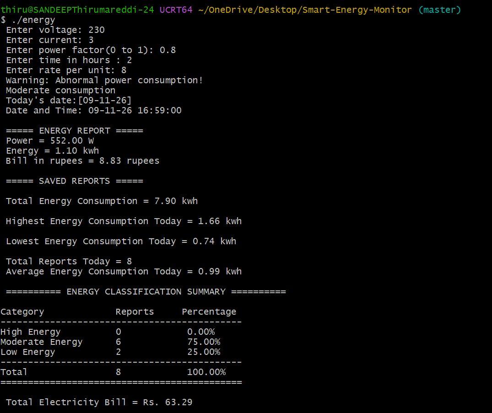

Smart Energy Usage \& Energy Monitoring Simulator

## About the Project

A C-based application that simulates an electrical energy monitoring system. It accepts voltage, current, power factor, usage time, and electricity tariff as inputs to calculate power consumption, energy usage, and estimated electricity bills.

The application also stores reports with date and time and provides daily summaries, including total, average, highest, and lowest energy consumption.

## Objectives

- Calculate electrical power and energy consumption.
- Simulate voltage and current readings.
- Estimate electricity bills using configurable tariffs.
- Validate user inputs and identify abnormal power readings.
- Generate and store reports with date and time.
- Calculate daily total, average, highest, and lowest energy consumption.
- Classify energy consumption as Low, Moderate, or High.

## Technologies

- Programming Language: C
- Domain: Embedded Systems and Basic Electrical Engineering
- Concepts: Power, Energy, Electricity Billing, File Handling, Date and Time
- Tools: GCC Compiler, Git, GitHub, Visual Studio Code

## Project Structure

```text
Smart-Energy-Monitor/
├── docs/       # Project documentation
├── include/    # Header files
├── images/     # Program output screenshots
├── src/        # C source code
├── .gitignore  # Files ignored by Git
└── README.md   # Project documentation
```

## Features

- Calculates electrical power using voltage, current, and power factor.
- Calculates energy consumption in kWh.
- Estimates electricity bills based on the configured tariff.
- Validates user inputs.
- Identifies abnormal power readings.
- Generates reports with date and time.
- Stores and retrieves consumption records.
- Displays daily energy summaries.
- Calculates total, average, highest, and lowest energy consumption.
- Classifies consumption as Low, Moderate, or High.

## How to Run

- Clone this repository.
- Compile the source code using GCC:
  gcc src/main.c -o energy
- Run the program:
  ./energy
- Enter the requested electrical parameters to view the results.

## Project Status

Completed the core features of the Smart Energy Monitor project, including:

- Electrical power and energy calculations
- Electricity bill estimation
- Input validation
- Date and time-based report generation
- Daily energy summaries
- Energy classification
- Total, average, highest, and lowest energy calculations

Further enhancements may be added in the future.

Important Note

This is a software simulation. It does not measure actual electrical quantities or connect to physical hardware.

## Project Output



```

```
